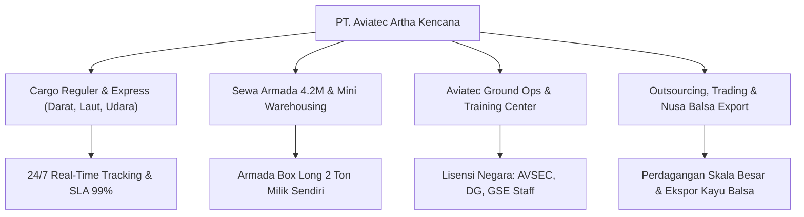

# ✈️ PT. Aviatec Artha Kencana — Enterprise Corporate Portal V2

[](LICENSE)
[](https://developer.mozilla.org/en-US/docs/Web/HTML)
[](https://developer.mozilla.org/en-US/docs/Web/CSS)
[](https://developer.mozilla.org/en-US/docs/Web/JavaScript)
[](https://greensock.com/)
[](https://lenis.darkroom.engineering/)
[](https://aviatec-artha.vercel.app/)

Website Corporate Profile resmi **PT. Aviatec Artha Kencana** versi 2 (V2), dirancang dengan standar desain industrial-modern bereputasi tinggi yang memadukan estetika editorial high-contrast, interaktivitas smooth-scroll, dan integrasi operasional logistik serta pusat pelatihan aviasi.

🔗 **Production Live Portal:** [https://aviatec-artha.vercel.app](https://aviatec-artha.vercel.app)

---

## ✨ Fitur & Keunggulan Utama Desain

1. **Pixel-Perfect Aesthetic & Tipografi Premium**:
   - Tipografi resmi **Satoshi** (Regular, Medium, Bold, Black) yang di-host lokal 100% mandiri di dalam folder `fonts/`.
   - Layout high-contrast brutalist-industrial yang elegan, bersih, dan profesional.
2. **Animasi & Interaktivitas Berkelas Dunia**:
   - **Lenis Smooth Scroll**: Pengalaman scrolling ultra-mulus (*inertial dampening*).
   - **GSAP & ScrollTrigger**: Reveal animasi pada elemen manifesto, statistik, kartu pilar bisnis, dan efek parallax scrub.
   - **SplitText Line Masking**: Teks judul dan paragraf bertransisi per baris secara dinamis saat di-scroll.
   - **Auto-Cycle Capabilities Tabs**: Tab layanan yang berganti secara otomatis setiap interval dengan visual progress bar real-time, dapat diklik manual sewaktu-waktu.
   - **Infinite Dual-Lane Marquee**: Badge berjalan (*running text*) yang halus untuk menonjolkan nilai ARTA dan keunggulan armada.
   - **Interactive WhatsApp QR Modal**: Terintegrasi engine `kjua.js` untuk menghasilkan kode QR WhatsApp secara live dan interaktif di layar, siap dipindai kamera smartphone pelanggan.
3. **100% Mandiri & Bebas Ketergantungan Eksternal**:
   - Seluruh aset CSS (`normalize.css`, `webflow.css`, `cip-harvin.webflow.css`, `bundle.css`), JS (`gsap`, `ScrollTrigger`, `SplitText`, `lenis`, `kjua`, `bundle.js`), dan Font tersimpan rapi secara lokal di dalam folder aset.

---

## 📋 Struktur Pilar Layanan Perusahaan



1. **Hero Section**:
   - Headline: *"Aman. Cepat. Terpercaya."*
   - Narasi singkat integrasi hulu-ke-hilir: armada mandiri dan SDM bersertifikat dari lembaga pelatihan milik sendiri.
2. **Profil & Kapasitas (`#who`)**:
   - 4 Kartu Statistik Mengambang (*Floating Stats Cards*):
     - **NIB RESMI**: Perizinan Berbasis Risiko RI
     - **99%**: Ketepatan Jadwal Pengiriman
     - **100%**: SDM Lulusan Lembaga Sendiri
     - **4.2 M**: Mobil Box Long Milik Sendiri Kapasitas 2 Ton
3. **Pilar Bisnis & Layanan (`#what`)**:
   - **Cargo Reguler & Express**: Pengiriman darat, laut, udara antar kota (1–3 hari) & 1 hari sampai (Express).
   - **Sewa Armada & Mini Warehousing**: Mobil Box Long 4.2M 2 Ton + Driver (harian/bulanan), GPS live, dan titip barang sementara.
   - **Aviatec Ground Ops Center & Training Center**: Pusat pelatihan resmi GSE Staff, Airlines Staff, AVSEC, dan Dangerous Goods (Cargo DG).
   - **Outsourcing, Trading & Nusa Balsa**: Penyedia tenaga kerja terampil industri dan ekspor Indonesia Natural Balsa Wood.
4. **Keunggulan Kompetitif & Nilai ARTA (`#why-us`)**:
   - **Nilai ARTA**: Aman, Responsive, Tepat Waktu, Akuntabel.
   - **SDM Lembaga Sendiri**: Standar keselamatan dan disiplin aviasi.
   - **Armada Sendiri Tanpa Calo**: Efisiensi biaya dan ketersediaan unit terjamin.

---

## 📁 Struktur Direktori

```text
V2/
├── css/                  # Stylesheet industrial, Satoshi typography & layout
├── fonts/                # Web fonts Satoshi lokal
├── images/               # Aset foto armada, sertifikasi, logo mitra, dan avatar
├── js/                   # Bundle GSAP, ScrollTrigger, SplitText, Lenis & KJUA
├── favicon.ico           # Ikon favicon perusahaan
├── index.html            # Dokumen HTML portal utama
├── LICENSE               # Lisensi MIT
├── package.json          # Metadata proyek
└── README.md             # Dokumentasi arsitektur portal
```

---

## 🚀 Cara Menjalankan di Lokal

Karena portal ini dibangun dengan arsitektur web modern mandiri:
1. Cukup buka file `index.html` langsung di browser Anda, ATAU
2. Jalankan lokal HTTP server (misal dengan ekstensi VS Code *Live Server* atau `npx serve .`).

---

## 👨‍💻 Pengembang (Author)

**Rizkia Nuari Fujiana**  
*Fullstack & Software Engineer*  
- **GitHub:** [@luminariadev](https://github.com/luminariadev)
- **Live Portal:** [aviatec-artha.vercel.app](https://aviatec-artha.vercel.app/)

---

## 📄 Lisensi

Proyek ini dilisensikan di bawah [MIT License](LICENSE) © 2026 Rizkia Nuari Fujiana.
